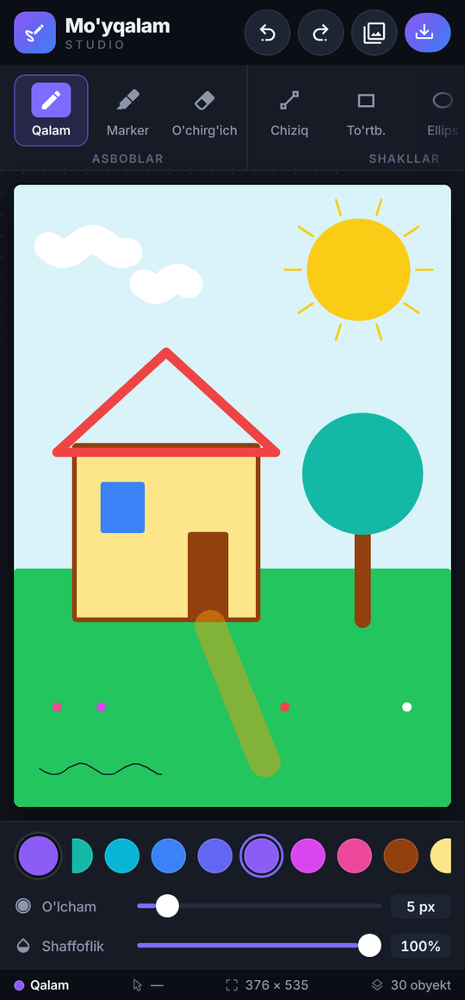
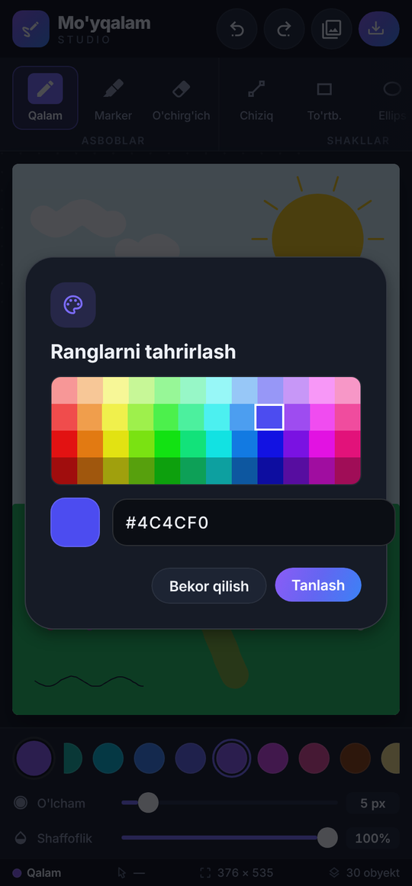
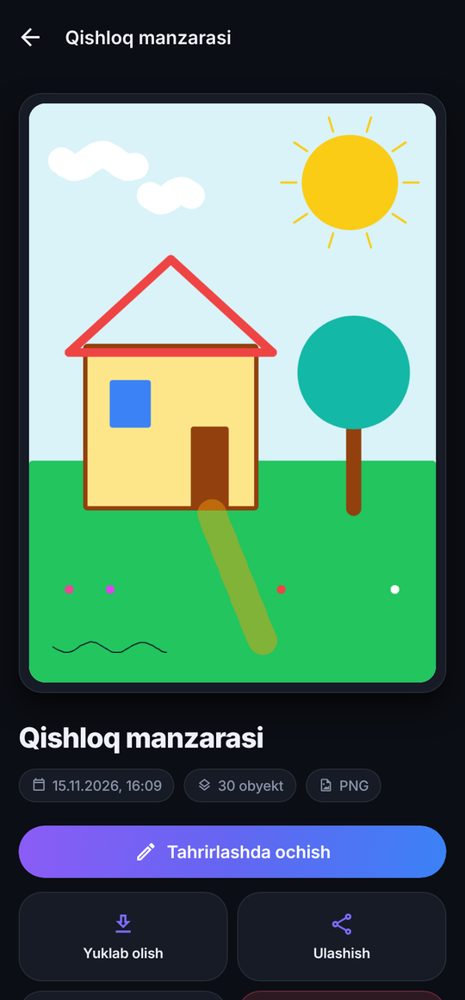
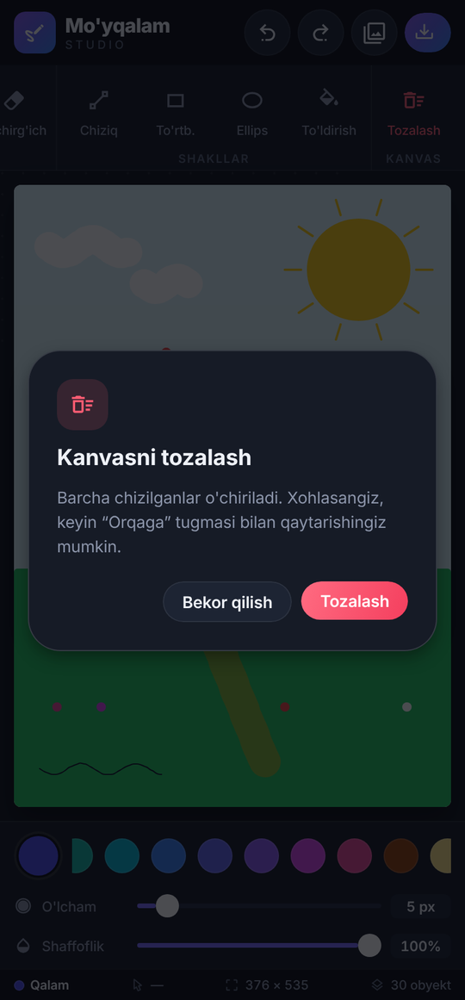
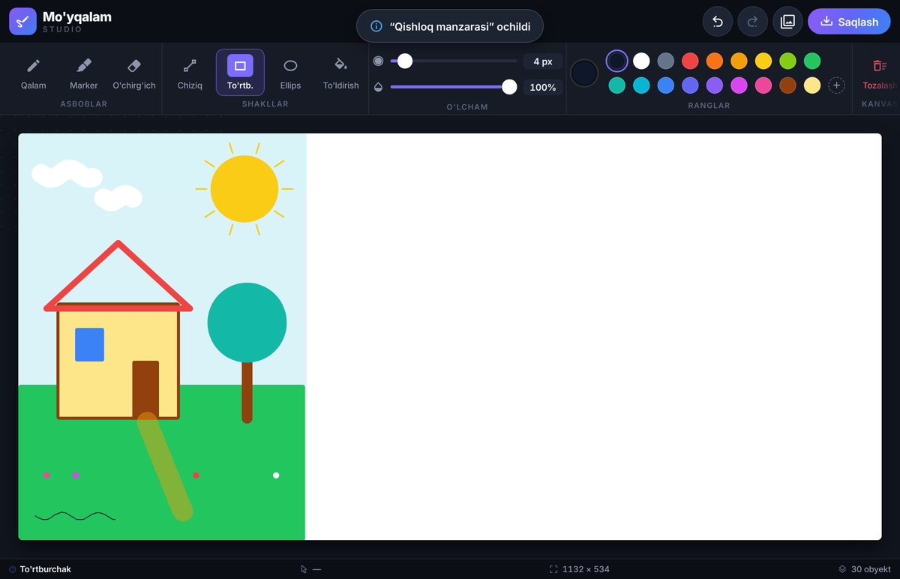
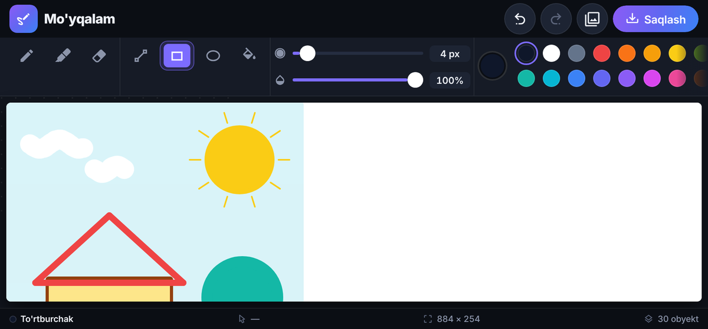

# 🎨 Mo'yqalam Studio — chizish (Paint) ilovasi

**Mo'yqalam Studio** — barmoq bilan rasm chizish uchun professional uslubdagi oflayn mobil ilova. Interfeysi Microsoft Paint'ga o'xshatib qurilgan: yuqorida guruhlangan **asboblar lentasi (ribbon)**, markazda oq kanvas, pastda **status satri** (kursor koordinatasi, kanvas o'lchami, obyektlar soni). Ilova internetsiz to'liq ishlaydi, barcha ma'lumotlar telefonning o'zida saqlanadi.

| | |
|---|---|
| **Fan** | Mobil ilovalarni ishlab chiqish |
| **Topshiriq** | 29-variant — Chizish (Paint) ilovasi |
| **Talaba** | Xudoyberganov Diyorbek Zarifboy o'g'li |
| **O'qituvchi** | Sarvarbek Azimov |
| **Platforma** | Android, iOS (React Native + Expo), qo'shimcha ravishda Web |

---

## 📸 Skrinshotlar

| Kanvas | Ranglarni tahrirlash | Nomni tekshirish |
|:---:|:---:|:---:|
|  |  |  |

| Mening rasmlarim | Rasmni ko'rish | Tozalashni tasdiqlash |
|:---:|:---:|:---:|
|  |  |  |

**Planshet / keng ekran** — o'lcham va ranglar ham lentaga joylashadi, xuddi Paint'dagidek:



**Yotiq telefon** — lenta ixcham rejimga o'tadi, kanvasga ko'proq joy qoladi:



---

## ✅ Topshiriq talablari va ularning bajarilishi

| Talab (topshiriqdan) | Holat | Qayerda amalga oshirilgan |
|---|:---:|---|
| Barmoq bilan chizish | ✅ | `src/components/DrawingCanvas.tsx` — `PanResponder` + SVG |
| Qalam rangini tanlash | ✅ | 18 ta tayyor rang + spektr to'ri + HEX kod (`ColorPalette.tsx`, `ColorInputModal.tsx`) |
| Qalam qalinligini tanlash | ✅ | Slayder 1–48 px (`SliderRow.tsx`) |
| O'chirg'ich | ✅ | Alohida asbob, o'z qalinligi bilan |
| Undo / Redo **to'g'ri ishlaydi** | ✅ | `src/logic/history.ts` — 9 ta unit test bilan tekshirilgan |
| Kanvasni tozalash | ✅ | Tasdiqlash oynasi bilan; tozalashni ham undo qilish mumkin |
| Rasmni **PNG** sifatida saqlash | ✅ | `react-native-view-shot` → `expo-file-system` (`drawingRepository.ts`) |

### Qo'shimcha imkoniyatlar

- **6 ta asbob:** qalam, marker (yarim shaffof), o'chirg'ich, chiziq, to'rtburchak, ellips.
- **Shakllarni to'ldirish** (fill) va **shaffoflik** (10–100%) sozlamasi.
- **Paint uslubidagi interfeys:** guruhlangan lenta, status satri, nuqtali ish maydoni, to'q "studio" mavzusi, Inter shrifti.
- **Ranglarni tahrirlash oynasi:** 48 rangli spektr to'ri + HEX kod.
- **Avtomatik saqlash (qoralama):** ilova yopilib qayta ochilganda chizma joyida qoladi.
- **Sozlamalar eslab qolinadi:** asbob, rang, qalinlik, shaffoflik.
- **"Mening rasmlarim" galereyasi:** nomi bo'yicha qidirish bilan.
- **Saqlangan rasmni qayta tahrirlash:** obyektlar ham saqlanadi, rasm kanvasga qaytadi.
- **Telefon galereyasiga eksport** va **ulashish** (Telegram, Gmail va h.k.).
- **Nomini o'zgartirish** va **o'chirish** (tasdiqlash bilan).
- **Moslashuvchan dizayn:** tik telefon, yotiq telefon (ixcham lenta) va planshet (to'liq lenta).
- **Tebranish (haptic)** — asbob yoki rang tanlanganda yengil tebranish.

---

## 🛡️ Barqarorlik va noto'g'ri kiritishlarni tekshirish

| Holat | Ilova javobi |
|---|---|
| Bo'sh kanvasni saqlashga urinish | "Kanvas bo'sh — avval biror narsa chizing" xabari |
| Rasm nomi bo'sh yoki faqat probel | "Rasm nomini kiriting." |
| Nom 2 belgidan qisqa / 40 dan uzun | Tegishli xato xabari |
| Nomda `\ / : * ? " < > \|` belgilari | Xato xabari (fayl nomi uchun taqiqlangan) |
| Takroriy nom (katta-kichik harf farqsiz) | "Bu nom bilan rasm allaqachon saqlangan." |
| Noto'g'ri HEX rang (`#12ZZ`) | "Noto'g'ri rang kodi..." |
| Tasodifiy teginish bilan juda kichik shakl | Shakl qo'shilmaydi (4 px dan kichik) |
| Bo'sh kanvasni tozalash | Tugma faol emas, tarixga "bo'sh" qadam yozilmaydi |
| Undo/redo qiladigan narsa yo'q | Tugmalar xira (faol emas) |
| Saqlangan ma'lumot buzilgan yoki eski formatda | Ilova qulamaydi — noto'g'ri yozuvlar tashlanadi, yetishmagan maydonlar to'ldiriladi |
| Galereyaga saqlashga ruxsat berilmasa | Tushunarli xabar, ilova ishlashda davom etadi |

Internet, server yoki Firebase **ishlatilmaydi**.

---

## 🧰 Texnologiyalar

| Texnologiya | Vazifasi |
|---|---|
| **React Native 0.88 + Expo SDK 58** | Bitta kod bilan Android va iOS |
| **TypeScript** (strict) | Turlar orqali xatolarni oldindan aniqlash |
| `react-native-svg` | Chiziq va shakllarni vektor ko'rinishida chizish |
| `react-native-view-shot` | Kanvasni PNG rasmga aylantirish |
| `expo-file-system` | PNG fayllarni ilova papkasida saqlash |
| `@react-native-async-storage/async-storage` | Qoralama, sozlamalar va rasmlar ro'yxati (lokal baza) |
| `expo-media-library`, `expo-sharing` | Galereyaga saqlash va ulashish |
| `@react-navigation/native-stack` | Ekranlar orasida navigatsiya |
| `expo-linear-gradient`, `@expo-google-fonts/inter` | Gradientlar va Inter shrifti (ilova ichida, oflayn) |
| `expo-haptics` | Tebranish orqali javob |
| `@react-native-community/slider` | O'lcham va shaffoflik slayderlari |
| **Jest** (`jest-expo`), **Prettier** | Unit testlar, kod formati |

---

## 🏗️ Arxitektura

Kod qatlamlarga ajratilgan: **model → mantiq → ma'lumot → hook → UI**. Har bir qatlam faqat o'zidan pastdagisini ishlatadi.

```
src/
├── models/        # Turlar: Point, Stroke, Tool, SavedDrawing, BrushSettings
├── constants/     # Dizayn tizimi (theme), palitra, asbob nomlari, chegaralar
├── logic/         # Sof funksiyalar — UI va bazasiz, testlar bilan qoplangan
│   ├── history.ts      # undo/redo reduceri
│   ├── path.ts         # nuqtalar → silliq SVG path (Bezier)
│   ├── shapes.ts       # to'rtburchak/ellips geometriyasi, shaffoflik
│   ├── color.ts        # HSL → HEX, spektr to'ri
│   ├── validation.ts   # kiritishlarni tekshirish
│   └── cursorStore.ts  # status satri uchun kursor koordinatasi
├── data/          # Saqlash qatlami
│   ├── drawingRepository.ts       # saqlangan rasmlar (CRUD)
│   ├── draftStorage.ts            # qoralama (avto-saqlash)
│   ├── settingsStorage.ts         # sozlamalar
│   ├── imageFiles.ts / .web.ts    # PNG fayllar (telefon / brauzer)
│   └── imageExport.ts / .web.ts   # galereyaga saqlash, ulashish
├── hooks/         # useDrawingHistory, useBrushSettings — holat + saqlashni birlashtiradi
├── components/    # UI: AppBar, Ribbon, DrawingCanvas, ColorPalette, StatusBar, modallar...
├── screens/       # CanvasScreen, GalleryScreen, ViewerScreen
└── navigation/    # Stack navigator va ekran parametrlari turlari
__tests__/         # Jest unit testlar (35 ta)
```

### Asosiy ekran tuzilishi (Paint uslubi)

```
┌─────────────────────────────────────────────────────────┐
│ ▣ Mo'yqalam            ↶  ↷  🖼  [ Saqlash ]            │  AppBar
├───────────────┬───────────────────────┬────────┬────────┤
│ ✎  🖍  ⌫      │  ╱  ▭  ◯  🪣          │ ●──── │  🗑     │  Ribbon (lenta)
│   ASBOBLAR    │       SHAKLLAR        │O'LCHAM │ KANVAS │
├───────────────┴───────────────────────┴────────┴────────┤
│ · · · · · · · · · · · · · · · · · · · · · · · · · · · · │
│ ·  ┌───────────────────────────────────────────────┐  · │  Workspace
│ ·  │                 KANVAS (oq)                   │  · │
│ ·  └───────────────────────────────────────────────┘  · │
├─────────────────────────────────────────────────────────┤
│ ◉  ● ● ● ● ● ● ● ● ●   O'lcham ────●──  Shaffoflik ──● │  Dock (telefonda)
├─────────────────────────────────────────────────────────┤
│ ● Qalam   ↖ 139, 125 px   ⛶ 376 × 535   ◈ 30 obyekt     │  Status satri
└─────────────────────────────────────────────────────────┘
```

### Undo/Redo qanday ishlaydi

Kanvas holati — obyektlar ro'yxati (`Stroke[]`). Tarix uchta qismdan iborat:

```
past:    [ [], [A], [A,B] ]     ← oldingi holatlar
present: [A,B,C]                 ← ekranda ko'rinayotgan
future:  []                      ← bekor qilinganlar (redo uchun)
```

- **Yangi obyekt / tozalash / rasm ochish** → `present` `past` ga o'tadi, `future` tozalanadi.
- **Undo** → `past` dan oxirgisi `present` bo'ladi, eski `present` `future` boshiga qo'yiladi.
- **Redo** → teskarisi.
- Tarix 100 qadam bilan cheklangan (xotirani tejash uchun).

### Ekranlar sxemasi

```
┌──────────────┐  🖼 tugmasi  ┌──────────────┐   rasm    ┌───────────────┐
│    Kanvas    │ ───────────▶ │  Galereya    │ ────────▶ │ Rasmni ko'rish│
│ (bosh ekran) │ ◀─────────── │  (qidiruv)   │           │  (amallar)    │
└──────────────┘ "Tahrirlash" └──────────────┘           └───────────────┘
```

---

## 🚀 Ishga tushirish

**Talab:** Node.js 20+ va telefonda [Expo Go](https://expo.dev/go) ilovasi (yoki Android emulyator).

```bash
# 1. Kutubxonalarni o'rnatish
npm install

# 2. Ishga tushirish
npx expo start
```

Terminalda chiqqan **QR kodni** telefondagi Expo Go ilovasi bilan skanerlang (telefon va kompyuter bitta Wi-Fi tarmog'ida bo'lishi kerak). Emulyatorda ochish uchun terminalda `a` tugmasini bosing.

Kompyuter brauzerida ko'rish: `npx expo start --web`

### APK yaratish

```bash
npm install -g eas-cli
eas login                                  # bepul Expo akkaunti
eas build -p android --profile preview     # tayyor .apk fayl havolasi beriladi
```

### Testlar va tekshiruvlar

```bash
npm test            # 35 ta unit test (undo/redo, path, shakllar, ranglar, validatsiya, saqlash)
npm run typecheck   # TypeScript tekshiruvi
npm run format      # Prettier bilan kod formati
```

---

## 🧪 Qo'lda sinov ro'yxati

- [x] Internet o'chirilgan holda chizish, saqlash, galereya ishlaydi
- [x] Ilova yopilib qayta ochilganda chizma va sozlamalar saqlanib qoladi
- [x] Undo → Redo → yangi obyekt: redo tarixi to'g'ri tozalanadi
- [x] Tozalash → Undo: chizma qaytadi
- [x] Shakllar istalgan yo'nalishda tortilganda to'g'ri chiziladi, to'ldirish ishlaydi
- [x] Bo'sh nom, takroriy nom, noto'g'ri belgilar, noto'g'ri HEX — xato xabari chiqadi
- [x] Saqlangan PNG galereyada ko'rinadi, qidiriladi, ochiladi, ulashiladi, o'chiriladi
- [x] Tik/yotiq telefon va planshetda dizayn buzilmaydi

---

## 🤖 AI'dan foydalanish

Topshiriq talabiga ko'ra, AI vositalari qayerda ishlatilgani:

- **Claude (Anthropic)** — loyiha tuzilmasini (qatlamlarga ajratish) rejalashtirish, undo/redo reduceri, chiziqlarni Bezier egri chiziqlari bilan silliqlash, shakllar geometriyasi, saqlash qatlami, Paint uslubidagi interfeys komponentlari kodini yozishda, unit testlarni tuzishda va README'ni tayyorlashda yordam berdi.
- Expo SDK 58 dagi yangi `expo-file-system` (File/Directory) API'si va `expo-media-library/legacy` importi AI yordamida aniqlandi.
- Kod ishga tushirilib sinab ko'rildi, testlar yozildi va kodning har bir qismi tushunib chiqildi (izohlar o'zbek tilida yozilgan).

---

## 📄 Litsenziya

MIT — [LICENSE](LICENSE)
